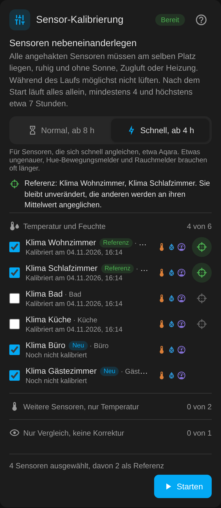
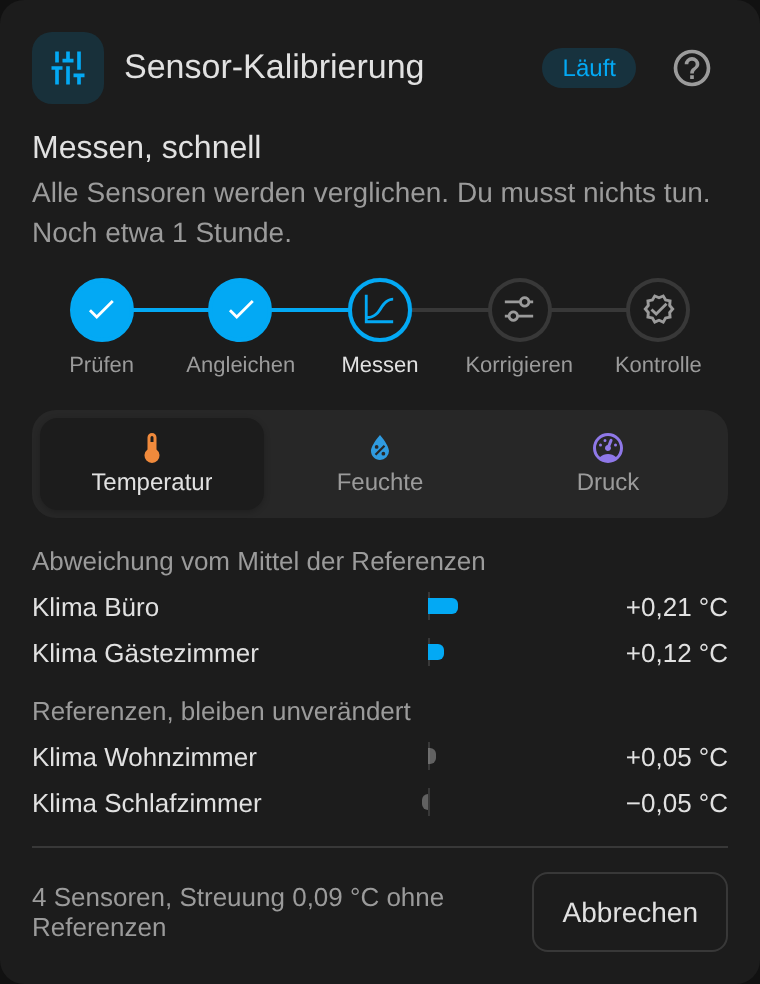
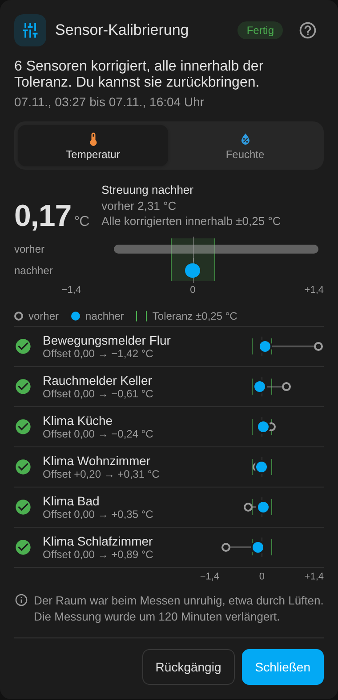

# Zigbee2MQTT Sensor-Kalibrierung für Home Assistant

[English](README.md)

Temperatur- und Feuchtesensoren nebeneinanderlegen, Start drücken und ein paar Stunden später wiederkommen. Die Integration ermittelt, wie weit jeder Sensor danebenliegt, und schreibt die Korrektur in die Kalibrier-Optionen von Zigbee2MQTT. Danach zeigen alle Sensoren wieder vergleichbare Werte.

Sie bringt eine eigene Kachel mit und braucht keine weiteren Erweiterungen.

<p>
  
  
  
</p>

## Was sie kann

- **Korrigieren:** Temperatur, Feuchte und Luftdruck von Zigbee2MQTT-Sensoren mit `temperature_calibration`, `humidity_calibration` oder `pressure_calibration`, etwa Aqara WSDCGQ11LM, Hue-Bewegungsmelder und viele Rauchmelder.
- **Vergleichen:** Jeder andere Temperatur- oder Feuchtesensor in Home Assistant (ZHA, deCONZ, WLAN, Thermostate) kann als Vergleich oder Referenz mitmessen, wird aber nie verändert.
- **Allein laufen:** Sie wartet, bis sich alle Sensoren angeglichen haben, misst, schreibt die Offsets und kontrolliert das Ergebnis. Ein Neustart von Home Assistant zwischendurch schadet nicht.
- **Unruhe ausblenden:** Lüften, Kochen oder Heizung verändern alle Sensoren gleichzeitig. Solche Zeiten zählen nicht, Messen oder Kontrolle werden bei Bedarf einmal verlängert.
- **Sicherung:** Die alten Offsets lassen sich mit einem Tipp wiederherstellen.

## Voraussetzungen

- Home Assistant 2026.2 oder neuer
- Zigbee2MQTT mit der MQTT-Integration und eingeschalteter Home-Assistant-Erkennung

## Installation

### HACS oder Marketplace

1. HACS öffnen (seit Home Assistant 2026.11: **Einstellungen > Marketplace**) und im Menü oben rechts **Benutzerdefinierte Repositories** wählen.
2. `https://github.com/Gartenhuhn/Home-Assistant-Sensorkalibrierung` eintragen, Typ **Integration**.
3. **Zigbee2MQTT Sensor-Kalibrierung** herunterladen und Home Assistant neu starten.
4. Weiter mit Schritt 3 unten.

### Von Hand

1. Den Ordner `custom_components/sensor_kalibrierung` nach `/config/custom_components/` kopieren.
2. Home Assistant neu starten.
3. Unter **Einstellungen > Geräte & Dienste** die Integration **Zigbee2MQTT Sensor-Kalibrierung** hinzufügen.
4. Im Dashboard eine Kachel vom Typ `custom:sensor-kalibrierung-card` anlegen. Falls sie fehlt, die Seite neu laden.

## Ablauf

1. **Sensoren auswählen und zusammenlegen.** Alle angehakten Sensoren müssen dicht nebeneinander an einem ruhigen Platz liegen, ohne Sonne, Zugluft oder Heizung. Nicht angehakte Sensoren bleiben unverändert.
2. **Art wählen.** *Normal* passt für alle Sensoren. *Schnell* reicht für Sensoren, die sich rasch angleichen, etwa Aqara.
3. **Starten.** Die Integration sichert die alten Optionen und stellt zwei Nachkommastellen ein.
4. **Angleichen.** Sie wartet, bis sich die Abstände zwischen den Sensoren nicht mehr ändern.
5. **Messen.** Sie vergleicht die Sensoren.
6. **Korrigieren und kontrollieren.** Sie setzt die neuen Offsets und prüft das Ergebnis.
7. **Zurückbringen.** Kachel und Benachrichtigung melden das Ende.

| | Normal | Schnell |
|---|---|---|
| Angleichen | 2 bis 8 Stunden | 1 bis 4 Stunden |
| Messen | 4 Stunden | 2 Stunden |
| Kontrolle | 2 Stunden | 1 Stunde |
| Gesamt | 8 bis 14 Stunden | 4 bis 7 Stunden |

Die Zeiten für *Normal*, die größte automatische Korrektur und die Empfänger der Benachrichtigungen stehen in den Optionen der Integration. Das Fragezeichen in der Kachel öffnet eine Kurzanleitung, die auch alle Anzeigen und Hinweise erklärt.

## Neue und zurückgesetzte Sensoren

- **Neue Sensoren** tragen in der Kachel 14 Tage lang die Markierung *Neu*, bis sie kalibriert sind.
- **Referenz:** Zwei oder drei kalibrierte Sensoren neben die neuen legen und in ihrer Zeile rechts auf die Zielscheibe tippen. Sie werden automatisch mit ausgewählt und nicht verändert. Die neuen werden an den Mittelwert der Referenzen angeglichen. Ohne Referenz zählt der Mittelwert der Gruppe.
- **Zurückgesetzte Sensoren:** Die Offsets werden je IEEE-Adresse gespeichert. Verliert Zigbee2MQTT sie, etwa nach Entfernen und neu Anlernen, zeigt die Kachel *Offsets fehlen*. **Gespeicherte Offsets zurückschreiben** stellt sie ohne neue Messung wieder her.

## Ergebnis

Das Ergebnis zeigt die Streuung vorher und nachher, mit Referenz den größten Abstand zur Referenz, als zwei Spuren: grau vorher, blau nachher, die Toleranz als grünes Feld. Eine Grafik zeigt jeden Sensor vor (Ring) und nach (Punkt) der Korrektur, die Toleranz als grüne Linien:

| | Toleranz |
|---|---|
| Temperatur | ±0,25 °C |
| Feuchte | ±1 % |
| Luftdruck | ±0,3 hPa |

Sensoren, die nach der Korrektur außerhalb der Toleranz liegen, stehen als Hinweis darunter. Das letzte Ergebnis lässt sich jederzeit über **Ergebnis** wieder öffnen. **Rückgängig** stellt Offsets, Nachkommastellen und Kalibrierdaten von vor dem letzten Lauf wieder her.

## Rechenweg

Die Meldungen jedes Sensors werden auf ein 5-Minuten-Raster interpoliert. An jedem Rasterpunkt zählt der Abstand zum Median der Gruppe oder der Referenzsensoren. Das Ergebnis je Sensor ist der Median dieser Abstände. Ändert sich die Raumtemperatur, betrifft das alle Sensoren gleich. Rasterpunkte, an denen sich der ganze Raum schnell verändert, bleiben außen vor.

Bestehende Offsets bleiben während der Messung aktiv. Der neue Offset ist der alte Offset plus die Korrektur.

## Was nicht korrigiert wird

- **Ausreißer:** Korrekturen über den Grenzen in den Optionen (ab Werk 3 °C, 10 %, 5 hPa) werden nur gemeldet. Im Ergebnis lassen sie sich mit **Übernehmen** setzen, **Rückgängig** nimmt auch das zurück.
- **Instabile Sensoren:** Driftet ein Sensor während der Messung, bleibt sein Offset unverändert.
- **Stumme Sensoren:** Fehlen beim Messen mehr als 2 Stunden am Stück, wird der Sensor nicht korrigiert. Ein Sensor, der sich 90 Minuten nicht meldet, hält das Angleichen auf und löst eine Benachrichtigung aus.
- **Sensoren außerhalb von Zigbee2MQTT:** nur Vergleich oder Referenz.

## Grenzen

- **Abgleich, keine absolute Genauigkeit:** Die Sensoren werden aneinander oder an die Referenz angeglichen. Liegen alle in dieselbe Richtung daneben, liegen sie danach gemeinsam daneben. Wenn absolute Werte wichtig sind, einen verlässlichen Sensor als Referenz nehmen.
- **Nur Offset:** Zigbee2MQTT verschiebt den Messwert um einen festen Betrag. Das korrigiert den Fehler am Kalibrierpunkt, nicht Fehler, die mit dem Abstand dazu wachsen. Drinnen, etwa bei 18 bis 25 °C und 40 bis 65 %, spielt das kaum eine Rolle.
- **Außensensoren:** Vor dem Aufhängen drinnen kalibrieren. Bei Frost oder über etwa 85 % Feuchte bleiben Abweichungen von einigen Prozent Feuchte möglich, nach Nebel oder Tau bleiben viele Sensoren eine Weile bei fast 100 %.
- **Der Platz zählt mehr:** Sonne, eine warme Wand oder die Luft unter dem Dachüberstand verfälschen Außenwerte leicht um mehrere Grad. Ein belüfteter Strahlungsschutz bringt mehr als jede Kalibrierung.

## Dienste und Statussensor

`sensor_kalibrierung.start`, `.cancel`, `.dismiss`, `.rollback` und `.restore_offsets`

`sensor.sensor_kalibrierung_status` zeigt die Phase, etwa für Automationen. Seine Attribute enthalten das letzte Ergebnis, fehlende Offsets und neue Sensoren. Sie werden nicht aufgezeichnet.

## Sprache

Die Kachel folgt der Sprache der Home-Assistant-Oberfläche (Deutsch oder Englisch). Benachrichtigungen und Fehlermeldungen folgen der in Home Assistant eingestellten Sprache.

## Entwicklung

```bash
pip install pytest-homeassistant-custom-component
pytest
```

Änderungen: [CHANGELOG.md](CHANGELOG.md). Lizenz: MIT, siehe [LICENSE](LICENSE).
