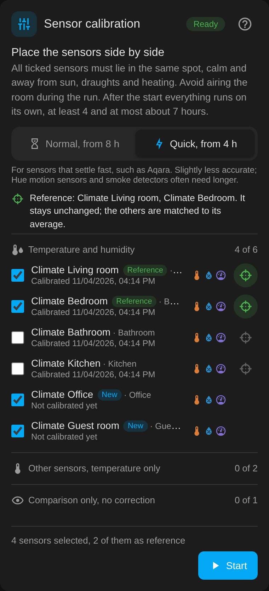
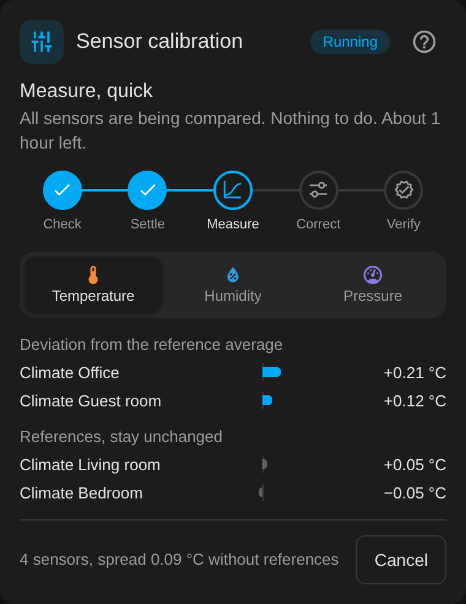
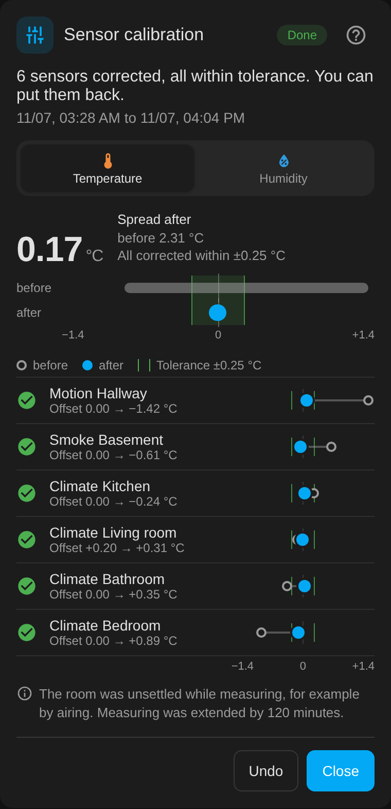

# Zigbee2MQTT Sensor Calibration for Home Assistant

[Deutsche Anleitung](README.de.md)

Place your temperature and humidity sensors side by side, press start, and come back a few hours later. The integration finds out how far each sensor is off and writes the correction into the sensor's Zigbee2MQTT calibration options. Afterwards all sensors show comparable values again.

It ships with its own dashboard card and needs no other extensions.

<p>
  
  
  
</p>

## What it does

- **Corrects** temperature, humidity and pressure of Zigbee2MQTT sensors that offer `temperature_calibration`, `humidity_calibration` or `pressure_calibration`, for example Aqara WSDCGQ11LM, Hue motion sensors and many smoke detectors.
- **Compares** any other temperature or humidity sensor in Home Assistant (ZHA, deCONZ, Wi-Fi, thermostats). These can take part as comparison or reference, but are never changed.
- **Runs on its own**: waits until all sensors have adapted, measures, writes the offsets and checks the result. Restarting Home Assistant in between does no harm.
- **Ignores unsettled phases**: airing, cooking or heating changes all sensors at once. Such periods are left out, and measuring or checking is extended once if needed.
- **Keeps a backup**: the previous offsets can be restored with one tap.

## Requirements

- Home Assistant 2026.2 or newer
- Zigbee2MQTT with the MQTT integration and Home Assistant discovery enabled

## Installation

### HACS or Marketplace

1. Open HACS (since Home Assistant 2026.11: **Settings > Marketplace**) and choose **Custom repositories** from the menu in the top right.
2. Add `https://github.com/Gartenhuhn/Home-Assistant-Sensorkalibrierung` as type **Integration**.
3. Download **Zigbee2MQTT Sensor Calibration** and restart Home Assistant.
4. Continue with step 3 below.

### Manually

1. Copy the folder `custom_components/sensor_kalibrierung` to `/config/custom_components/`.
2. Restart Home Assistant.
3. Add the integration **Zigbee2MQTT Sensor Calibration** under **Settings > Devices & services**.
4. Add a card of type `custom:sensor-kalibrierung-card` to a dashboard. If it is missing, reload the page.

## How a run works

1. **Select and place the sensors.** All ticked sensors must lie close together in a calm spot, away from sun, draughts and heating. Unticked sensors stay unchanged.
2. **Choose a mode.** *Normal* works for every sensor. *Quick* is enough for sensors that adapt fast, such as Aqara.
3. **Start.** The integration backs up the current options and sets two decimal places.
4. **Settle.** It waits until the distances between the sensors stop changing.
5. **Measure.** It compares the sensors.
6. **Correct and verify.** It writes the new offsets and checks the result.
7. **Put back.** The card and a notification report the end.

| | Normal | Quick |
|---|---|---|
| Settle | 2 to 8 hours | 1 to 4 hours |
| Measure | 4 hours | 2 hours |
| Verify | 2 hours | 1 hour |
| Total | 8 to 14 hours | 4 to 7 hours |

The times for *Normal*, the largest automatic correction and the notification targets are in the integration options. The question mark in the card opens a short guide that also explains every indicator and note.

## New and reset sensors

- **New sensors** are marked *New* in the card for 14 days until they are calibrated.
- **Reference:** place two or three calibrated sensors next to the new ones and tap the target icon on the right of their rows. They are selected automatically and not changed. The new sensors are matched to the reference average. Without a reference the group average counts.
- **Reset sensors:** offsets are stored per IEEE address. If Zigbee2MQTT loses them, for example after removing and re-pairing a device, the card shows *Offsets missing*. **Write back stored offsets** restores them without measuring again.

## Result

The result shows the spread before and after, or with a reference the largest distance to the reference, as two lanes: grey before, blue after, with the tolerance as a green area. A chart shows each sensor before (ring) and after (dot) the correction, with the tolerance as green lines:

| | Tolerance |
|---|---|
| Temperature | ±0.25 °C |
| Humidity | ±1 % |
| Pressure | ±0.3 hPa |

Sensors outside the tolerance after the correction are listed as a note. The last result can be reopened at any time with **Result**. **Undo** restores offsets, precision and calibration dates from before the last run.

## How it calculates

Each sensor's reports are interpolated onto a 5-minute grid. At every grid point the distance to the median of the group, or of the reference sensors, counts. A sensor's result is the median of these distances, so a changing room temperature affects all sensors equally. Grid points where the whole room changes quickly are left out.

Existing offsets stay active while measuring. The new offset is the old offset plus the correction.

## What is not corrected

- **Outliers:** corrections larger than the limits in the options (default 3 °C, 10 %, 5 hPa) are only reported. They can be applied in the result with **Apply**; **Undo** reverts that too.
- **Unstable sensors:** if a sensor drifts during the measurement, its offset stays unchanged.
- **Silent sensors:** sensors with more than 2 hours without a report while measuring are not corrected. A sensor that is silent for 90 minutes holds up settling and triggers a notification.
- **Sensors outside Zigbee2MQTT:** comparison or reference only.

## Services and status sensor

`sensor_kalibrierung.start`, `.cancel`, `.dismiss`, `.rollback` and `.restore_offsets`

`sensor.sensor_kalibrierung_status` shows the phase, for example for automations. Its attributes contain the last result, missing offsets and new sensors. They are not recorded.

## Language

The card follows the language of the Home Assistant user interface (German or English). Notifications and error messages follow the language set in Home Assistant.

## Development

```bash
pip install pytest-homeassistant-custom-component
pytest
```

Changes: [CHANGELOG.md](CHANGELOG.md). License: MIT, see [LICENSE](LICENSE).
